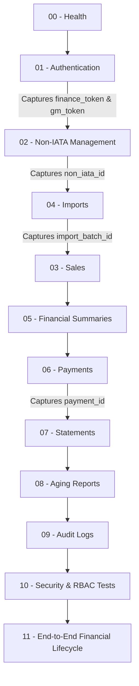

# Amoudi Financial Management — Postman API Documentation

This directory contains the official, production-ready Postman API collection and local environment configuration for the **Amoudi Financial Management System Backend** (Java 21, Spring Boot 3.4.3, PostgreSQL 18.6).

---

## 1. Files in This Directory

| File | Purpose |
| :--- | :--- |
| [`Amoudi-Financial-Management.postman_collection.json`](file:///c:/D%20One/Projects/Amoudi%20Financial%20System/Backend/postman/Amoudi-Financial-Management.postman_collection.json) | Complete API collection with 12 structured folders, 72 requests, automated auth capture, response validations, and financial invariant assertions. |
| [`Amoudi-Financial-Local.postman_environment.json`](file:///c:/D%20One/Projects/Amoudi%20Financial%20System/Backend/postman/Amoudi-Financial-Local.postman_environment.json) | Environment variable definitions for `http://localhost:8080`, default credentials, dynamic token extractors, and test fixtures. |
| [`generate_postman.py`](file:///c:/D%20One/Projects/Amoudi%20Financial%20System/Backend/postman/generate_postman.py) | Python generator script used to programmatically assemble the Postman v2.1.0 schema with syntax validation. |

---

## 2. Prerequisites

Before running the collection:

1. **PostgreSQL 18.6** must be running and listening on port `5432` with database `amoudi_financial`.
2. **Backend Application** must be running:
   ```powershell
   cd "c:\D One\Projects\Amoudi Financial System\Backend"
   mvn spring-boot:run
   ```
   (Wait until the console reports `Started AmoudiFinancialApplication in X seconds` on port `8080`).
3. **Postman App** (Desktop or Web) or **Newman** CLI installed.

---

## 3. Importing into Postman

1. Open Postman.
2. Click **Import** (top left).
3. Drag and drop both:
   - `Amoudi-Financial-Management.postman_collection.json`
   - `Amoudi-Financial-Local.postman_environment.json`
4. In the top right environment dropdown, select **Amoudi Financial - Local**.

---

## 4. Environment Variables Reference

| Variable | Default Value | Description |
| :--- | :--- | :--- |
| `base_url` | `http://localhost:8080` | Backend root host and port |
| `api_prefix` | `/api/v1` | Base API prefix |
| `finance_username` | `finance_user` | Username for Finance role |
| `finance_password` | `Admin@12345` | Password for Finance role |
| `gm_username` | `admin` | Username for General Manager role |
| `gm_password` | `Admin@12345` | Password for General Manager role |
| `finance_token` | *(auto-populated)* | Captured JWT token after Finance login |
| `gm_token` | *(auto-populated)* | Captured JWT token after GM login |
| `non_iata_id` | `1` | Target Non-IATA database ID |
| `non_iata_code` | `HAL01` | Non-IATA agency code |
| `sales_id` | `1` | Sales transaction database ID |
| `payment_id` | `1` | Payment transaction database ID |
| `import_batch_id` | `1` | Galileo/BSP import batch database ID |
| `excel_file` | `SEP- 17.xlsx` | Filename/path for Galileo/BSP Excel upload |
| `receipt_file` | `sample_receipt.pdf` | Filename/path for payment receipt upload |
| `statement_date_from` | `2026-09-01` | Statement start filter date |
| `statement_date_to` | `2026-09-30` | Statement end filter date |
| `aging_as_of_date` | `2026-09-30` | Aging report evaluation date |
| `current_date` | `2026-09-30` | Payment transaction date |

---

## 5. Recommended Execution Order

The collection is organized sequentially so that variables flow naturally across folders:



1. **`00 - Health`**: Verifies system is UP and PostgreSQL is connected.
2. **`01 - Authentication`**: Runs `Login as Finance` and `Login as General Manager`. Test scripts immediately capture the tokens into `{{finance_token}}` and `{{gm_token}}`.
3. **`02 - Non-IATA Management`**: Creates and lists Non-IATA sub-agents. Captures `{{non_iata_id}}`.
4. **`04 - Imports`**: Uploads `SEP- 17.xlsx` Galileo/BSP report.
5. **`03 - Sales`**: Queries imported ticket sales and proves immutability (POST/PUT/DELETE return 405).
6. **`05 - Financial Summaries`**: Inspects bulk and single balances; verifies $\text{Outstanding} = \sum(\text{Sales}) - \sum(\text{Payments})$.
7. **`06 - Payments`**: Posts account payments as GM, uploads receipt, retrieves receipt binary, and tests Finance cancellation.
8. **`07 - Statements`**: Retrieves chronological account statements and downloads Excel and PDF reports.
9. **`08 - Aging Reports`**: Verifies aging buckets (Current, 31-60, 61-90, 91-120, 120+) and downloads Excel and PDF exports.
10. **`09 - Audit Logs`**: Queries immutable audit trail as Finance.
11. **`10 - Security & RBAC Tests`**: Verifies 401 Unauthorized, 403 Forbidden boundaries, and 400 validation rejections.
12. **`11 - End-to-End Financial Lifecycle`**: Self-contained 15-step transaction lifecycle demonstrating financial reconciliation from scratch.

---

## 6. Role-Based Access Control (RBAC) Matrix

| Endpoint | Method | FINANCE | GENERAL_MANAGER | Unauthenticated |
| :--- | :---: | :---: | :---: | :---: |
| `/api/v1/health` | GET | **ALLOW (200)** | **ALLOW (200)** | **ALLOW (200)** |
| `/api/v1/auth/login` | POST | **ALLOW (200)** | **ALLOW (200)** | **ALLOW (200)** |
| `/api/v1/auth/me` | GET | **ALLOW (200)** | **ALLOW (200)** | **DENY (401)** |
| `/api/v1/non-iatas` (Create) | POST | **ALLOW (201)** | **DENY (403)** | **DENY (401)** |
| `/api/v1/non-iatas` (Read) | GET | **ALLOW (200)** | **ALLOW (200)** | **DENY (401)** |
| `/api/v1/non-iatas/{id}` (Update) | PUT | **ALLOW (200)** | **DENY (403)** | **DENY (401)** |
| `/api/v1/non-iatas/{id}/status` | PATCH | **ALLOW (200)** | **DENY (403)** | **DENY (401)** |
| `/api/v1/sales` (Read) | GET | **ALLOW (200)** | **ALLOW (200)** | **DENY (401)** |
| `/api/v1/sales` (Write) | POST/PUT/DELETE | **METHOD NOT ALLOWED (405)** | **METHOD NOT ALLOWED (405)** | **METHOD NOT ALLOWED (405)** |
| `/api/v1/imports` (Excel Upload) | POST | **ALLOW (201)** | **DENY (403)** | **DENY (401)** |
| `/api/v1/name-mappings` | POST | **ALLOW (201)** | **DENY (403)** | **DENY (401)** |
| `/api/v1/financial-summaries` | GET | **ALLOW (200)** | **ALLOW (200)** | **DENY (401)** |
| `/api/v1/payments` (Create) | POST | **DENY (403)** | **ALLOW (201)** | **DENY (401)** |
| `/api/v1/payments/{id}/receipt` (Upload) | POST | **DENY (403)** | **ALLOW (200)** | **DENY (401)** |
| `/api/v1/payments/{id}/receipt` (Download) | GET | **ALLOW (200)** | **ALLOW (200)** | **DENY (401)** |
| `/api/v1/payments/{id}/cancel` | POST | **ALLOW (200)** | **DENY (403)** | **DENY (401)** |
| `/api/v1/non-iatas/{id}/statement` | GET | **ALLOW (200)** | **ALLOW (200)** | **DENY (401)** |
| `/api/v1/aging` | GET | **ALLOW (200)** | **ALLOW (200)** | **DENY (401)** |
| `/api/v1/audit-logs` | GET | **ALLOW (200)** | **DENY (403)** | **DENY (401)** |

---

## 7. Mathematical Invariant Verification Scripts

The collection automatically asserts core financial invariants in JavaScript:

### 1. Financial Summary Formula
$$\text{Outstanding Balance} = \text{Total Sales} - \text{Total Posted Payments}$$
```javascript
var sales = Number(res.data.totalSales || 0);
var payments = Number(res.data.totalPayments || 0);
var balance = Number(res.data.outstandingBalance || 0);
var expected = Number((sales - payments).toFixed(2));
pm.expect(balance).to.eql(expected);
```

### 2. Account Statement Formula
$$\text{Closing Balance} = \text{Opening Balance} + \text{Total Period Sales} - \text{Total Period Payments}$$
```javascript
var openBal = Number(res.data.openingBalance || 0);
var sales = Number(res.data.totalSales || 0);
var payments = Number(res.data.totalPayments || 0);
var closeBal = Number(res.data.closingBalance || 0);
var expected = Number((openBal + sales - payments).toFixed(2));
pm.expect(closeBal).to.eql(expected);
```

### 3. Aging Buckets Sum Formula
$$\text{Total Outstanding} = \text{Current} + \text{Days 31--60} + \text{Days 61--90} + \text{Days 91--120} + \text{Days 120+}$$
```javascript
var cur = Number(res.data.totalCurrent || 0);
var d30 = Number(res.data.totalDays31To60 || 0);
var d60 = Number(res.data.totalDays61To90 || 0);
var d90 = Number(res.data.totalDays91To120 || 0);
var d120 = Number(res.data.totalDays120Plus || 0);
var total = Number(res.data.totalOutstanding || 0);
var expected = Number((cur + d30 + d60 + d90 + d120).toFixed(2));
pm.expect(total).to.eql(expected);
```

---

## 8. Automated Command-Line Execution (Newman)

To run the collection automatically via Newman:

```bash
# Run entire collection with environment
npx newman run postman/Amoudi-Financial-Management.postman_collection.json \
  -e postman/Amoudi-Financial-Local.postman_environment.json \
  --reporters cli
```

To run a specific folder (e.g. End-to-End Lifecycle):

```bash
npx newman run postman/Amoudi-Financial-Management.postman_collection.json \
  -e postman/Amoudi-Financial-Local.postman_environment.json \
  --folder "11 - End-to-End Financial Lifecycle"
```
